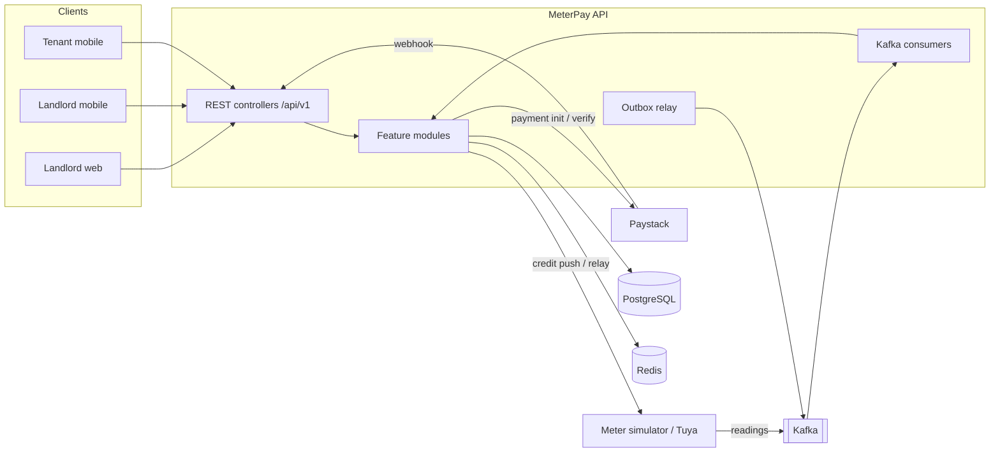
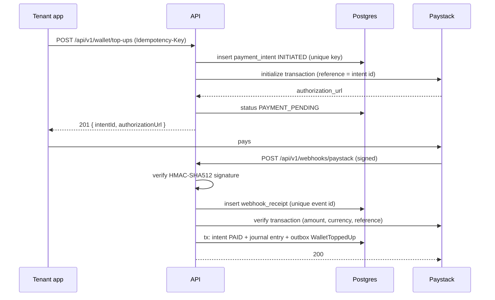

# MeterPay: System Design

Backend for a prepaid electricity sub-metering platform for multi-unit residential buildings in Nigeria. Served by React (landlord web) and React Native (landlord and tenant mobile) frontends, which live in separate repositories.

Base package: `com.theodomart.energy`

---

## 1. Problem

In Nigerian multi-unit buildings (flats, compounds, hostels), one utility meter usually feeds many households. Landlords split the bill by guesswork, tenants dispute it, and the landlord ends up pre-financing everyone's electricity. Prepaid sub-meters fix the hardware side, but someone still has to sell units, track consumption, collect money, and cut off defaulters fairly.

MeterPay lets a landlord register buildings, units and smart meters, set a tariff, and let tenants buy electricity from a wallet. Meters report readings, the platform deducts consumption from each meter's credit, and supply is cut off automatically when credit runs out and restored when the tenant buys more.

## 2. Goals and non-goals

**Goals**
- Correct money: every kobo traceable through a double-entry ledger
- Correct energy: every watt-hour of credit traceable through an append-only meter credit ledger
- Safe payments: idempotent, webhook-confirmed, reconciled
- Reliable telemetry ingestion: duplicate and out-of-order readings handled
- Runs locally with one command and no real hardware (meter simulator)

**Non-goals (v1)**
- Building the frontends in this repo
- Generating STS (Standard Transfer Specification) tokens for legacy keypad meters
- Payouts to landlord bank accounts (revenue is tracked, settlement is manual)
- Multi-currency

## 3. Glossary

| Term | Meaning |
|---|---|
| Building | A property owned or managed by a landlord |
| Unit | A flat or room inside a building |
| Tenancy | A tenant's assignment to a unit for a period |
| Meter | A smart sub-meter installed on a unit |
| Register | The meter's cumulative energy counter (Wh), only ever increases |
| Credit | Prepaid energy available on a meter (Wh) |
| Wallet | A tenant's money balance (kobo) |
| Vend | Converting wallet money into meter credit |
| Cutoff | Opening the meter relay when credit reaches zero |

## 4. Tech stack

| Concern | Choice |
|---|---|
| Language | Java 21 |
| Framework | Spring Boot (latest stable at M0, recorded in ADR-0001) |
| Build | Maven wrapper |
| Database | PostgreSQL 16, Flyway migrations |
| Cache, rate limiting | Redis 7, Bucket4j |
| Messaging | Apache Kafka (KRaft mode, no ZooKeeper) |
| Security | Spring Security with its OAuth2 resource server (Nimbus) for JWT access tokens, rotating refresh tokens |
| Payments | Paystack (behind `PaymentGateway` interface) |
| Meters | `MeterGateway` interface: simulator (default), Tuya adapter (optional profile) |
| API docs | springdoc-openapi |
| Testing | JUnit 5, AssertJ, Mockito, Testcontainers, WireMock, ArchUnit |
| Quality | JaCoCo (coverage gate), Spotless (formatting) |
| CI | GitHub Actions |
| Observability | Actuator, Micrometer, JSON logs with correlation IDs |

## 5. Architecture

Modular monolith. One deployable, internally split into feature modules with enforced boundaries (ArchUnit). Kafka is used for telemetry ingestion and for domain events leaving a module, published through a transactional outbox.



### 5.1 Package layout (package by feature)

```
com.theodomart.energy
├── MeterPayApplication.java
├── common/            errors, ProblemDetail handler, correlation ID filter, Clock bean, Money, Energy and Role types, paging response, constraint name lookup
├── security/          JWT issuing and verification, SecurityConfig, CurrentUser, ownership checks
├── identity/          users, registration, login, refresh tokens
├── property/          buildings, units, tenant invites, tenancies
├── meter/             meter registry, meter state machine
├── tariff/            tariff plans and versions
├── ledger/            accounts, journal entries, postings (money, kobo)
├── payment/           payment intents, Paystack adapter, webhooks, reconciliation
├── vending/           buy energy, meter credit ledger (Wh)
├── telemetry/         reading ingestion, consumption, cutoff and restore
├── alerting/          low credit, tamper detection, notifications
├── audit/             append-only hash-chained audit log
├── reporting/         consumption and revenue reports
├── outbox/            transactional outbox and relay
└── gateway/           MeterGateway interface, simulator, Tuya adapter
```

Inside each feature module:

```
{module}/
├── api/           controllers, request/response DTOs (records)
├── service/       interfaces, plus the view records, commands and exceptions in their signatures
├── serviceImpl/   implementations only
├── domain/        JPA entities, enums, domain logic
├── repository/    Spring Data repositories
├── event/         domain event records (if any)
└── config/        configuration properties and beans (if any)
```

`service` holds a module's whole public contract, because rule 2 below forbids other modules from reaching anywhere else. Enums in `domain` therefore cross module boundaries as strings in view records. `Role` lives in `common` because every module authorises against it.

Modules may depend on each other's `service` packages in both directions as long as the bean graph stays acyclic. Example: `property` calls `security`'s `OwnershipService`, which reads ownership through `property`'s `BuildingOwnerLookup`.

### 5.2 Architecture rules (enforced by ArchUnit tests)

1. Controllers and any other consumer depend on `service` interfaces, never on `serviceImpl`.
2. A module may only use another module through its `service` package and its `event` records (the contract its Kafka consumers read). No cross-module repository or entity access.
3. Controllers never return JPA entities, not even inside generics such as `ResponseEntity<List<Entity>>`. Only records.
4. `ledger`, `audit` and `tariff` repositories expose no delete methods: they may not extend `CrudRepository` or `JpaRepository`, which bring `deleteById` and friends, nor declare `delete*` or `remove*` methods.
5. No class outside `common` declares a `double`, `Double`, `float`, `Float` or `BigDecimal` field. This covers every field, not only money and energy, so renaming a field cannot dodge it (ADR-0002). Nothing here needs fractions: voltage is in decivolts, power in whole watts.
6. `ledger` depends on no other feature module except `security`. Every module that moves money calls the ledger, so the ledger calling back would tie money rules to the modules they serve. This is stricter than 5.1 allows for other modules. There is no general cycle rule: `property` and `security` already call each other's services (5.1), and Spring refuses a constructor cycle between beans at startup.

## 6. Domain model

### 6.1 Units of measure

- Money: `long` kobo, wrapped in a `Money` record. `BIGINT` in Postgres. Never `double`, `float` or `BigDecimal` in entities.
- Energy: `long` watt-hours (Wh), wrapped in an `Energy` record. `BIGINT` in Postgres.
- Tariff rates: kobo per kWh as `long`. Conversion from money to energy uses integer arithmetic with explicit rounding that never gives the tenant more energy than they paid for (floor of Wh delivered), documented in ADR-0005.
- Time: `Instant` in UTC everywhere, read from an injected `Clock`. Displayed in Africa/Lagos by clients.
- Calendar dates (`tenancies.starts_on`, `ends_on`): `DATE`, the current date in Africa/Lagos, because that is the day the landlord and tenant see.

### 6.2 Entities (core fields)

All tables: `id UUID PK`, `created_at TIMESTAMPTZ`, snake_case columns. Mutable tables also have `updated_at` and `version BIGINT` (optimistic locking).

**users**: `email UNIQUE`, `phone UNIQUE NOT NULL`, `password_hash`, `full_name`, `role` (LANDLORD, TENANT, ADMIN), `status` (ACTIVE, DISABLED). Uniqueness only holds on one canonical form, so both have a CHECK: `email` is trimmed and lower case, `phone` is E.164 (`+2348031234567`). Registration converts `08031234567` and `2348031234567` to E.164.

**refresh_tokens**: `user_id`, `token_hash UNIQUE` (SHA-256 hex), `family_id`, `expires_at`, `revoked_at`, `replaced_by`. CHECK: a replaced token is always revoked.

**buildings**: `landlord_id`, `name`, `address`, `state`, `lga`

**units**: `building_id`, `label` (e.g. "Flat 3B"). Unique index on (`building_id`, `lower(label)`), and labels are stored trimmed with inner spaces collapsed, so "Flat 3B" and "flat  3b" cannot both exist in one building.

**tenant_invites**: `unit_id`, `code_hash UNIQUE` (SHA-256 hex), `created_by`, `expires_at`, `accepted_at`, `accepted_by`, `revoked_at`. Partial unique index: one open invite per unit (`accepted_at` and `revoked_at` both NULL). See 8.5.

**tenancies**: `unit_id`, `tenant_id`, `starts_on`, `ends_on NULL`, `status` (ACTIVE, ENDED). Partial unique index: one ACTIVE tenancy per unit. CHECKs: `ends_on` is set exactly when ENDED, and is not before `starts_on`. Ended rows stay as history.

**meters**: `landlord_id`, `unit_id UNIQUE NULL`, `serial_number UNIQUE`, `gateway_type` (SIMULATED, TUYA), `external_device_id`, `status`, `last_register_wh`, `last_reading_at`, `credit_balance_wh`, `low_credit_threshold_wh`. `landlord_id` gives a meter an owner before it is assigned to a unit. Serials are stored upper case (CHECK) and are unique across all landlords, since a serial is one physical device. CHECK: a TUYA meter needs `external_device_id`. `credit_balance_wh` has no sign check, because credit can overshoot below zero before cutoff (7.2). `low_credit_threshold_wh` defaults to 5000 when registering. `status_before_suspension` holds the state to resume to, and is set exactly when `status` is SUSPENDED (CHECK). One row is one installation, so an assigned meter cannot be moved to another unit (see 17). From M7-07: `assigned_at`, `decommissioned_at`, and `serial_number` and (`gateway_type`, `external_device_id`) become unique only among meters that are not decommissioned, so a refurbished device can be registered again as a new row.

**tariff_plans**: `building_id UNIQUE`, `name`. One plan per building, because a purchase only knows its meter's building and so has no way to choose between plans. The plan is created with the building's first version and does not change after that.
**tariff_versions**: `plan_id`, `rate_kobo_per_kwh`, `platform_fee_basis_points`, `effective_from`. Versions are immutable. The active version is the latest with `effective_from <= now`. UNIQUE(`plan_id`, `effective_from`). A landlord sets only the rate and the effective date. The platform fee is the platform's rate, from config (`meterpay.tariff`), and is copied onto each new version so that changing it never reprices an existing one: a new fee is a commercial change, and reaches a building when its landlord next sets a price. An effective date in the past is refused, because a backdated version would claim a price applied when tenants were charged something else.
A landlord can withdraw a version only before it starts (not built yet, M7-04a). `withdrawn_at` is set by one conditional UPDATE, with the time from the injected `Clock`, `WHERE id = ? AND effective_from > ? AND withdrawn_at IS NULL`. If no row changes the answer is 409, because the version has started and can only be replaced by a newer one. The active version lookup ignores withdrawn rows, and the unique rule on `plan_id`, `effective_from` becomes a partial index on rows that are not withdrawn, so the same moment can be rescheduled. A version that has ever applied to a purchase is therefore permanent.
**tax_rates**: `vat_basis_points` (750 = 7.5%), `effective_from UNIQUE`. VAT is a legal rate that applies to every building, not part of a landlord's price, so it is not stored on tariff versions. Rows are immutable, and a law change is one new row with a future `effective_from`, added by a migration: every building then changes on that date with nothing for landlords to do. The application only reads this table, and V9 seeds the first row because a purchase cannot be priced without one.

**ledger_accounts**: `owner_type` (TENANT, LANDLORD, PLATFORM), `owner_id NULL`, `type` (see 6.3), `currency` ('NGN'), `balance_kobo`, `version`. UNIQUE NULLS NOT DISTINCT(`owner_type`, `owner_id`, `type`): platform accounts have no owner, and a plain UNIQUE treats NULLs as different, so it would allow duplicates. CHECKs: `owner_id` is NULL exactly for PLATFORM, each type belongs to one kind of owner (6.3), and only TENANT_WALLET has a floor of zero.

**journal_entries**: `entry_type` (WALLET_TOPUP, ENERGY_PURCHASE, REFUND, ADJUSTMENT), `reference_type`, `reference_id` (both or neither), `idempotency_key UNIQUE` (not blank), `description`, `posted_at`
**postings**: `journal_entry_id`, `account_id`, `direction` (DEBIT, CREDIT), `amount_kobo > 0`

**payment_intents**: `tenant_id`, `amount_kobo`, `status`, `idempotency_key UNIQUE`, `gateway`, `gateway_reference UNIQUE`, `authorization_url`, `failure_reason`, `paid_at`
**payment_events**: append-only log of every gateway interaction (`intent_id`, `event_type`, `payload JSONB`, `correlation_id`)
**webhook_receipts**: `gateway`, `event_id UNIQUE`, `signature_valid`, `payload JSONB`, `processed_at`

**energy_purchases**: `tenant_id`, `meter_id`, `amount_kobo`, `vat_basis_points`, `vat_kobo`, `fee_kobo`, `net_kobo`, `energy_wh`, `tariff_version_id`, `journal_entry_id`, `idempotency_key UNIQUE`, `status` (COMPLETED, CREDIT_PUSH_PENDING, CREDIT_PUSHED)
**meter_credit_entries**: append-only. `meter_id`, `type` (PURCHASE, CONSUMPTION, ADJUSTMENT), `delta_wh` (signed), `balance_after_wh`, `reference_id`

**meter_readings**: `meter_id`, `register_wh`, `voltage_dv` (decivolts), `power_w`, `relay_closed BOOLEAN`, `read_at`, `received_at`. UNIQUE(`meter_id`, `read_at`). Partitioned by month (range on `read_at`) from M6.

**alerts**: `meter_id`, `type` (LOW_CREDIT, CUTOFF, TAMPER_REGISTER_DECREASE, TAMPER_CONSUMPTION_WHILE_CUTOFF, READING_GAP, and from M7-07 METER_REPLACED_UNBILLED_GAP), `severity`, `status` (OPEN, ACKNOWLEDGED, RESOLVED), `details JSONB`

**audit_log**: append-only. `actor_id`, `action`, `target_type`, `target_id`, `payload JSONB`, `prev_hash`, `hash`, `occurred_at`. `hash = SHA-256(prev_hash || canonical_json(row without hash))`.

**outbox_events**: `aggregate_type`, `aggregate_id`, `event_type`, `payload JSONB`, `correlation_id NOT NULL`, `created_at`, `published_at NULL`, `attempts`. `OutboxWriter` copies `correlation_id` from the MDC, or generates one when there is none (scheduled jobs), so every event can be traced.

### 6.3 Ledger accounts

| Account | Owner | Normal balance |
|---|---|---|
| TENANT_WALLET | Tenant (one per user, created at registration) | Credit (liability: money we hold for the tenant) |
| LANDLORD_REVENUE | Landlord | Credit |
| GATEWAY_CLEARING | Platform | Debit (money in transit from Paystack) |
| VAT_PAYABLE | Platform | Credit |
| PLATFORM_FEE_REVENUE | Platform | Credit |

**Invariants (tested):**
- Every journal entry has at least two postings and total debits equal total credits.
- Postings and journal entries are never updated or deleted. Corrections are new reversing entries. The database enforces this with a statement trigger (V12) that refuses any UPDATE or DELETE on either table, so a script cannot break it either. TRUNCATE is still possible, and so is disabling the trigger as the table owner: production should run the application as a role that does not own these tables.
- A TENANT_WALLET balance can never go below zero. Enforced in code under a row lock or optimistic version check, plus a DB CHECK on a constrained balance column.
- `SUM(balance_kobo)` across accounts, signed by normal balance, is always zero. A scheduled job verifies this and raises an alert if not.

**Posting (M3-03).** `LedgerService.post` checks the lines balance before anything is written, then inserts the entry and its postings, then updates each account once, with the net of its lines, in order of the account id as text (the order Postgres sorts a UUID column, so later SQL locking can use `ORDER BY id` and agree). Updates in one fixed order stop two entries over the same accounts from deadlocking. A wallet short of funds stops the whole entry with 422 `INSUFFICIENT_WALLET_BALANCE`; a concurrent change to an account fails the optimistic version check. Called on its own, `post` runs each attempt in a new transaction and retries that failure, up to 3 attempts in all with a short random pause, then gives 409 `CONCURRENT_MODIFICATION`. Inside a caller's transaction it does not retry, because the failed attempt has spoiled that transaction: the caller retries its whole unit of work, as M5-03 must. `post` joins the caller's transaction, so a purchase and its entry commit together. Posting is idempotent (M3-04): the entry is inserted with `ON CONFLICT (idempotency_key) DO NOTHING` before any balance moves. If the key is taken, the existing entry is returned and nothing changes, provided the type, reference and lines match; otherwise 422 `IDEMPOTENCY_KEY_REUSED`. Catching the unique violation instead would abort the caller's transaction, which in a purchase is the purchase itself.

### 6.4 Posting recipes

**Wallet top-up confirmed (₦5,000):**
| Account | Debit | Credit |
|---|---|---|
| GATEWAY_CLEARING | 500000 | |
| TENANT_WALLET | | 500000 |

**Energy purchase (₦2,000, VAT 7.5% inclusive, fee 2%):**
- gross = 200000, vat = gross × 750 / 10750 (rounded half up, ADR-0010) = 13953, fee = (gross − vat) × 200 / 10000 (floor) = 3720, net = gross − vat − fee = 182327

| Account | Debit | Credit |
|---|---|---|
| TENANT_WALLET | 200000 | |
| VAT_PAYABLE | | 13953 |
| PLATFORM_FEE_REVENUE | | 3720 |
| LANDLORD_REVENUE | | 182327 |

Energy delivered = floor(net_kobo × 1000 / rate_kobo_per_kwh) Wh. At ₦225/kWh (22500 kobo): floor(182327 × 1000 / 22500) = 8103 Wh. VAT and fees come out of the amount paid, so they reduce the energy instead of being charged on top (ADR-0005).

## 7. State machines

### 7.1 Payment intent

```
INITIATED --gateway init ok--> PAYMENT_PENDING
INITIATED --gateway init failed--> FAILED
PAYMENT_PENDING --webhook charge.success / verify success--> PAID
PAYMENT_PENDING --webhook failed / verify failed--> FAILED
PAYMENT_PENDING --expired (60 min) after final verify--> FAILED
PAID --refund issued--> REFUNDED
```

- The intent row is created and committed BEFORE calling Paystack.
- `idempotency_key` = SHA-256(`tenant_id` + client `Idempotency-Key` header). Enforced by the UNIQUE constraint, not by check-then-insert. A duplicate insert returns the existing intent.
- Transitions are guarded in one place (`PaymentIntent.transitionTo`). Illegal transitions throw `IllegalStateTransitionException` (409).
- PAID is reached at most once. The wallet credit posting uses `idempotency_key = "topup:" + intent_id`, so even a double webhook cannot double-credit.

### 7.2 Meter

```
PROVISIONED --assigned to unit + first reading--> ACTIVE
ACTIVE --credit <= threshold--> LOW_CREDIT
LOW_CREDIT --credit > threshold--> ACTIVE
ACTIVE|LOW_CREDIT --credit <= 0--> CUTOFF          (relay open command sent)
CUTOFF --purchase credits meter--> ACTIVE          (relay close command sent)
any operational --tamper rule fires--> TAMPER_SUSPECTED
TAMPER_SUSPECTED --admin/landlord clears--> previous state
any --landlord suspends--> SUSPENDED
SUSPENDED --landlord resumes--> previous state
any --decommission--> DECOMMISSIONED (terminal)
```

"Operational" means ACTIVE, LOW_CREDIT and CUTOFF, so a PROVISIONED meter has no tamper or credit moves. No state moves to itself. A purchase on a CUTOFF meter always goes through ACTIVE, even if the new credit is below the threshold. `MeterStatus` is the only place that defines these moves, and `Meter.transitionTo` the only way to make one.

Suspending saves the current state in `status_before_suspension`, and a suspended meter can then move only to that state or to DECOMMISSIONED, so no other flow can reactivate it. Repeating a suspend, or resuming a meter that is not suspended, is a 409. A suspension does not open the relay yet: see 16.

Credit enforcement is two-layered: the purchased Wh is pushed to the meter (edge enforced), and the cloud independently opens the relay at zero (cloud enforced). If the meter keeps reporting consumption while CUTOFF, a TAMPER_CONSUMPTION_WHILE_CUTOFF alert fires.

## 8. Key flows

### 8.1 Wallet top-up



Fallbacks: a reconciliation job runs every 5 minutes and verifies PAYMENT_PENDING intents older than 10 minutes. `GET /api/v1/wallet/top-ups/{id}` also triggers a verify when the intent is still pending.

### 8.2 Buy energy

1. `POST /api/v1/meters/{meterId}/purchases` with amount and `Idempotency-Key`.
2. Check the caller is the active tenant of the meter's unit.
3. Load the active tariff version and the VAT rate, both as of one reading of the `Clock`, so a purchase at midnight cannot mix an old price with a new rate. A purchase records the VAT rate it used. The tariff version is cached in Redis, evicted on new version. The VAT rate is not cached: it is one small indexed lookup, and a row added by migration would not evict anything.
4. In one transaction: post the journal entry (fails with 422 `insufficient-wallet-balance` if the wallet is short), insert `energy_purchases`, append `meter_credit_entries` PURCHASE, update `meters.credit_balance_wh` with optimistic locking, write outbox `EnergyPurchased`.
5. Outbox relay publishes the event. A consumer calls `MeterGateway.pushCredit` and, if the meter was CUTOFF, `setRelay(CLOSED)`. Retries with backoff. Purchase moves to CREDIT_PUSHED.

### 8.3 Telemetry ingestion

1. Simulator (or Tuya bridge) publishes `MeterReading` to topic `meter.readings.v1`, keyed by `meter_id` (preserves per-meter ordering).
2. Consumer inserts into `meter_readings`. A duplicate (`meter_id`, `read_at`) is ignored (idempotent consumer).
3. Older-than-last readings are stored but do not trigger deduction.
4. First reading on a meter row (`last_reading_at IS NULL`): set `last_register_wh` and deduct nothing, and skip the falling-register check. A counter starts at an arbitrary number on any device, new or reused, so treating it as usage would charge the tenant for the device's earlier history.
5. Otherwise `consumed_wh = register_wh − meters.last_register_wh`. If negative, raise TAMPER_REGISTER_DECREASE and skip deduction.
6. Append CONSUMPTION credit entry, update balance, evaluate thresholds, transition meter state, emit `LowCredit` / `MeterCutoff` events.
7. Failed messages go to `meter.readings.v1.DLT` after 3 retries.

The simulator publishes `meter_id` directly. A Tuya bridge resolving a device id to a meter must only look among meters that are not decommissioned, or readings from a reused device could land on the old row.

### 8.4 Kafka topics

| Topic | Key | Producer | Consumer |
|---|---|---|---|
| `meter.readings.v1` | meter_id | simulator / Tuya bridge | telemetry |
| `energy.events.v1` | aggregate_id | outbox relay | vending (credit push), alerting |
| `meter.readings.v1.DLT` | meter_id | error handler | manual replay |

The outbox relay copies `correlation_id` into a Kafka header, `X-Correlation-Id`, not the payload. Consumers restore it into the MDC and clear it afterwards, so one top-up can be traced from the HTTP request through Kafka to the meter credit push. Retries and the DLT keep the header. It is never used for deduplication or authorisation.

### 8.5 Tenant onboarding

1. `POST /api/v1/units/{id}/invites` by the owning landlord. Refused with 409 `UNIT_OCCUPIED` if the unit has an active tenancy. Any earlier open invite for the unit is cancelled.
2. The response holds the code (`K7MPQ-2XR9T`): 10 characters without look-alikes, about 49 bits. It is shown only this once, stored only as a SHA-256 hash, works once and expires after 7 days. Case, spaces and dashes are ignored when it is typed.
3. The tenant calls `POST /api/v1/auth/register` with `inviteCode`. Its presence is what makes the account a TENANT: clients never send a role.
4. In one transaction: insert the user, lock the invite row (`SELECT ... FOR UPDATE`), insert the tenancy, mark the invite accepted. Redeeming requires an existing transaction (`Propagation.MANDATORY`). A bad code or a duplicate account leaves no user behind and an unused code still usable.
5. From M3-02a, a tenant who already has an account calls `POST /api/v1/tenancies/redeem` instead of registering, and keeps the same wallet.
6. `POST /api/v1/units/{id}/tenancy/end` ends the tenancy and frees the unit for a new invite.

## 9. API (v1)

All endpoints under `/api/v1`. JSON. Pagination via `page` (default 0) and `size` (1 to 100, default set per endpoint; beyond the limit is a 400, not clamped), returns `{ content, page, size, totalElements }`. Lists use a stable sort ending in `id`. Mutating money endpoints require an `Idempotency-Key` header.

**Auth**
| Method | Path | Role |
|---|---|---|
| POST | /auth/register | public (LANDLORD or TENANT via invite code) |
| POST | /auth/login | public |
| POST | /auth/refresh | public (refresh token) |
| POST | /auth/logout | authenticated |
| GET | /me | authenticated |
| GET | /me/tenancies | TENANT (M2-07) |
| POST | /me/password | authenticated (M8-07) |
| POST | /tenancies/redeem | TENANT (M3-02a) |

- `register` body: `email`, `phone`, `password` (at least 10 characters, at most 72 bytes), `fullName`, optional `inviteCode` (present means TENANT, absent means LANDLORD). Returns 201 with the user.
- `login` and `refresh` return `accessToken`, `tokenType` (`Bearer`), `expiresIn`, `refreshToken`, `refreshTokenExpiresIn` (seconds).
- `refresh` and `logout` bodies: `refreshToken`. `logout` revokes that session's token family and always returns 204, so it cannot probe which tokens exist. The access token stays valid until it expires.
- `/me/password` body: `currentPassword`, `newPassword`. Revokes every refresh token family, so a stolen session does not survive, then returns a fresh token pair so the caller stays signed in. A wrong current password is 422, not 401: clients treat 401 as an expired session.
- `/me/tenancies` returns `{ tenancies: [...] }`, active tenancies only, newest first. Each has `tenancyId`, `buildingId`, `buildingName`, `unitId`, `unitLabel`, `startsOn` and `meter` (`id`, `serialNumber`, `status`, `creditBalanceWh`, or null if the unit has no meter). Not paged, because a tenant has only a few; it is an object so paging or other fields can be added later without breaking clients. Credit reads 0 until purchases exist (M5-02).
- `/tenancies/redeem` body: `inviteCode`. Returns 201 with the tenancy. The same code rules and errors as registering with a code: 422 `INVALID_INVITE_CODE` for any unusable code, 409 `UNIT_OCCUPIED`.

**Property**
| Method | Path | Role |
|---|---|---|
| POST, GET | /buildings | LANDLORD |
| GET, PATCH | /buildings/{id} | LANDLORD (owner) |
| POST, GET | /buildings/{id}/units | LANDLORD (owner) |
| POST | /units/{id}/invites | LANDLORD (owner): creates tenant invite code |
| POST | /units/{id}/tenancy/end | LANDLORD (owner) |

- `PATCH /buildings/{id}` is partial: absent fields stay as they are, blank ones are a 400.
- `POST /units/{id}/invites` returns 201 with `code`, `unitId`, `expiresAt`. See 8.5.

**Meters and tariffs**
| Method | Path | Role |
|---|---|---|
| POST | /meters | LANDLORD: register meter |
| PUT | /meters/{id}/unit | LANDLORD: assign to unit |
| GET | /meters/{id} | LANDLORD (owner), TENANT (occupant) |
| POST | /meters/{id}/suspend, /resume | LANDLORD (owner) |
| POST | /meters/{id}/replace | LANDLORD (owner): see 17 (M7-07) |
| GET | /meters/{id}/readings?from&to | owner, occupant |
| POST, GET | /buildings/{id}/tariffs | LANDLORD (owner): new version |

- `POST /meters` body: `serialNumber`, `gatewayType`, `externalDeviceId` (required for TUYA), optional `lowCreditThresholdWh`.
- `PUT /meters/{id}/unit` body: `unitId`. Repeating it for the same unit is a no-op. 409 if the unit already has a meter or the meter is on another unit.
- `POST /buildings/{id}/tariffs` body: `rateKoboPerKwh`, optional `effectiveFrom` (default now), optional `planName` (used only by the building's first version, default `Standard`). `GET` returns versions newest first, each with an `active` flag. 409 if a version already starts at that moment.
- `GET /meters/{id}`: a former tenant, another tenant and another landlord all get 404.

**Wallet and payments**
| Method | Path | Role |
|---|---|---|
| GET | /wallet | TENANT |
| GET | /wallet/transactions | TENANT |
| POST | /wallet/top-ups | TENANT |
| GET | /wallet/top-ups/{id} | TENANT (owner) |
| POST | /webhooks/paystack | Paystack (signature verified) |

**Vending**
| Method | Path | Role |
|---|---|---|
| POST | /meters/{id}/purchases | TENANT (occupant) |
| GET | /meters/{id}/purchase-quote?amountKobo= | TENANT (occupant) (M5-03a) |
| GET | /meters/{id}/purchases | owner, occupant |

**Alerts, reports, admin**
| Method | Path | Role |
|---|---|---|
| GET | /alerts | LANDLORD (own buildings) |
| POST | /alerts/{id}/acknowledge, /resolve | LANDLORD (owner) |
| GET | /reports/buildings/{id}/consumption?period | LANDLORD (owner) |
| GET | /reports/buildings/{id}/revenue?period | LANDLORD (owner) |
| GET | /admin/audit/verify | ADMIN: verifies hash chain |
| GET | /admin/ledger/trial-balance | ADMIN |

## 10. Error handling

A single `@RestControllerAdvice` maps exceptions to RFC 9457 `ProblemDetail`:

```json
{
  "type": "https://meterpay.theodomart.com/problems/insufficient-wallet-balance",
  "title": "Insufficient wallet balance",
  "status": 422,
  "detail": "Wallet balance is ₦1,200.00 but the purchase requires ₦2,000.00",
  "instance": "/api/v1/meters/6f1c.../purchases",
  "code": "INSUFFICIENT_WALLET_BALANCE",
  "traceId": "a1b2c3d4"
}
```

| Exception | Status | code |
|---|---|---|
| `MethodArgumentNotValidException`, `ConstraintViolationException` | 400 | VALIDATION_FAILED (with `errors[]` field list) |
| `InvalidRequestException` (rules only a service can check), malformed JSON | 400 | VALIDATION_FAILED |
| `AuthenticationException`, `InvalidCredentialsException`, `InvalidRefreshTokenException` | 401 | UNAUTHENTICATED |
| `AccessDeniedException` (wrong role) | 403 | FORBIDDEN |
| `ResourceNotFoundException`, unknown route | 404 | NOT_FOUND |
| Wrong HTTP method | 405 | METHOD_NOT_ALLOWED |
| Unacceptable `Accept` header | 406 | NOT_ACCEPTABLE |
| Unsupported `Content-Type` | 415 | UNSUPPORTED_MEDIA_TYPE |
| `IllegalStateTransitionException` | 409 | ILLEGAL_STATE_TRANSITION |
| `OptimisticLockingFailureException` (after retries) | 409 | CONCURRENT_MODIFICATION |
| `DuplicateAccountException` (email or phone taken) | 409 | DUPLICATE_ACCOUNT |
| `DuplicateResourceException` (unit label, meter serial, meter assignment) | 409 | DUPLICATE_RESOURCE |
| `UnitOccupiedException` | 409 | UNIT_OCCUPIED |
| `IdempotencyConflictException` (same key, different body) | 422 | IDEMPOTENCY_KEY_REUSED |
| `InvalidInviteCodeException` (unknown, used, cancelled or expired, all alike) | 422 | INVALID_INVITE_CODE |
| `InvalidCurrentPasswordException` (M8-07) | 422 | INVALID_CURRENT_PASSWORD |
| `InsufficientWalletBalanceException` | 422 | INSUFFICIENT_WALLET_BALANCE |
| `MeterNotOperationalException` | 422 | METER_NOT_OPERATIONAL |
| `RateLimitExceededException` | 429 | RATE_LIMITED (+ `Retry-After`) |
| `PaymentGatewayException` | 502 | PAYMENT_GATEWAY_ERROR |
| anything else | 500 | INTERNAL_ERROR (no stack trace in body, logged with traceId) |

Ownership failures on another landlord's resources return 404, not 403, with the same body as a resource that does not exist, so resource IDs cannot be probed. 403 is only for the wrong role.

Failures inside the security filter chain never reach `@RestControllerAdvice`, so 401 and 403 are handed to Spring MVC's exception resolver and get the same problem detail, plus `WWW-Authenticate: Bearer` (`error="invalid_token"` for a bad token). Clients branch on `code`, so names must not change once released.

## 11. Security

- Passwords: BCrypt (strength 12; only the test profile lowers it, for speed). At least 10 characters. More than 72 bytes is refused, because BCrypt silently ignores the rest.
- Login: one message and exactly one BCrypt check for an unknown email, a wrong password and a disabled account (a dummy hash when the email is unknown), so neither the body nor the timing reveals which emails are registered.
- Access token: JWT, 15 minutes, HS256 secret from env (`JWT_SECRET`, at least 32 bytes, or the app refuses to start), claims `iss`, `sub`, `iat`, `exp`, `role` and no personal data. The algorithm is pinned to HS256, with 30 seconds of clock skew allowed.
- Refresh token: opaque random 256-bit, stored as SHA-256, 30 days from each rotation, rotated on every use. Reuse of a rotated token revokes the whole family, and that revocation is committed even though the request fails with 401. The row is locked during refresh, so of several concurrent uses exactly one succeeds and the rest count as reuse. A disabled user's family is revoked on their next refresh.
- Ownership checks live in services, not only in controllers: `OwnershipService` for buildings and units. A meter has its own `landlord_id`, checked in `MeterServiceImpl`. Role checks use `@PreAuthorize` on controllers.
- `/me` reloads the user, so a valid token for a disabled user gets 401 there. Other endpoints trust the token until it expires (see 16).
- Invite codes: see 8.5.
- The first ADMIN: see 17.
- Paystack webhook: HMAC-SHA512 of the raw body with the secret key, compared in constant time. Endpoint excluded from JWT but rate limited and IP allowlist optional.
- Rate limits (Bucket4j + Redis): login 5/min per IP+email, money endpoints 20/min per user, global 300/min per IP.
- No secrets in the repo. `.env.example` documents every variable.
- CORS restricted to configured frontend origins.

## 12. Observability

- `X-Correlation-Id` header accepted if it is 1 to 64 characters of `[A-Za-z0-9._-]`, otherwise replaced with a generated UUID (this blocks log injection). Put in MDC by a filter that runs before Spring Security, returned in responses, printed in every log line and included as `traceId` in problem details.
- JSON logs in prod profile. Payment logs always include `intentId` and `correlationId`.
- Metrics: `meterpay.payments.paid`, `meterpay.vends.total`, `meterpay.readings.ingested`, `meterpay.readings.lag`, `meterpay.ledger.imbalance`.
- Actuator health groups for liveness and readiness (DB, Redis, Kafka).

## 13. Testing strategy

| Layer | Tooling | What |
|---|---|---|
| Unit | JUnit 5, AssertJ | money/energy math, tariff calc, state machines, hash chain |
| Slice | `@WebMvcTest`, named `*Test` and run by Surefire because they need no Docker | controllers, validation, problem details |
| Integration | `@SpringBootTest` + Testcontainers (Postgres, Redis, Kafka), named `*IT`, run by Failsafe, sharing singleton containers | flows end to end, Flyway migrations, real constraints |
| External | WireMock | Paystack init, verify, failures, timeouts |
| Architecture | ArchUnit | rules in 5.2, each also run against deliberately broken fixtures to prove it fails |
| Concurrency | `ExecutorService` + `CountDownLatch` | 20 parallel purchases on one wallet never overdraw; double webhook credits once |

Coverage gate: JaCoCo fails the build below 75% line coverage on `serviceImpl`, `domain` and `ledger` packages (per package; 60% until M8-06). Badge published in README.

Integration tests share one database and do not clean it up, so each test creates its own users with unique emails and phones, or rolls back.

Required named tests (portfolio evidence):
- `ConcurrentPurchaseIT.parallelPurchasesNeverOverdrawWallet`
- `PaystackWebhookIT.duplicateWebhookCreditsWalletOnce`
- `PaystackWebhookIT.invalidSignatureIsRejected`
- `LedgerInvariantTest.everyJournalEntryBalances`
- `TelemetryIT.duplicateReadingIsIgnored`
- `TelemetryIT.firstReadingSetsBaselineWithoutDeduction`
- `TelemetryIT.registerDecreaseRaisesTamperAlert`
- `CutoffIT.meterIsCutOffAtZeroAndRestoredAfterPurchase`
- `AuditChainTest.tamperedRowBreaksVerification`

## 14. Local run and deployment

- `docker compose up` starts Postgres, Redis, Kafka (KRaft), the API and the meter simulator with seed data (one landlord, one building, three units, three tenants, three simulated meters).
- Profiles: `local` (simulator, Paystack test keys or WireMock stub; reads `.env`), `test` (fixed test JWT secret, BCrypt strength 4), `prod` (Tuya optional, JSON logs).
- Ports and secrets are configured in `.env`, copied from `.env.example`. `JWT_SECRET` has no default: generate one with `openssl rand -base64 48`. From M3-06a: `BOOTSTRAP_ADMIN_EMAIL`, `BOOTSTRAP_ADMIN_PHONE`, `BOOTSTRAP_ADMIN_PASSWORD` (all or none).
- Dockerfile: multi-stage, layered jar, non-root user.
- PostgreSQL 15 or later in every environment, because V10 uses `UNIQUE NULLS NOT DISTINCT`: an older server fails that migration. Local and test pin `postgres:16-alpine`, and production must match the same major version.
- Prod target: Oracle Always Free VM behind Nginx, subdomain `meterpay.theodomart.com`, Let's Encrypt.

## 15. Architecture decision records (docs/adr)

| ADR | Decision |
|---|---|
| 0001 | Modular monolith over microservices |
| 0002 | Money and energy as integer minor units |
| 0003 | Double-entry ledger instead of a balance column |
| 0004 | Transactional outbox instead of publishing to Kafka inside the transaction |
| 0005 | Tariff, VAT and fee rounding rules |
| 0006 | Two-layer credit enforcement (edge + cloud) |
| 0007 | Idempotency via DB unique constraint |
| 0008 | Hash-chained audit log |
| 0009 | MeterGateway abstraction and simulator |
| 0010 | Round VAT half up (supersedes the VAT rounding in 0005) |

## 16. Open design questions

Not decided yet. Each one needs a decision before the point named in the last column.

| Question | Why it matters | Needed by |
|---|---|---|
| Should there be a `GET /meters` for landlords? | A landlord cannot list their meters without knowing the ids. | Landlord dashboard |
| Should invite codes be HMAC-hashed with a server secret? | About 49 bits under plain SHA-256 could be brute-forced offline from a leaked table inside the 7-day window. | Before launch |
| Should concurrent refreshes get a short grace window? | A mobile client that retries on a bad connection is treated as reuse and logged out. | Mobile client testing |
| Should disabling a user take effect immediately on every endpoint? | Only `/me` and refresh check today, so a disabled user's access token works for up to 15 minutes. | M7-04 |
| Should `register` and `refresh` get their own rate limit? 11 only covers login, money endpoints and a global limit. | Guessing invite codes and mass registration are limited only by the global 300/min per IP. | M8-01 |
| Should suspending a meter open the relay, and resuming close it? 7.2 names relay commands only for CUTOFF, so today a suspension blocks purchases (M5-03) but leaves the power on. | A landlord may expect suspend to cut the supply, while cutting it could be used to pressure a tenant who has paid. | M5-05 |
| Do readings keep deducting credit while a meter is suspended, and can `resume` land on a state the credit no longer fits? | A meter suspended as ACTIVE can reach zero credit while suspended, and only resume or decommissioning can take a meter out of SUSPENDED. | M6-04 |
| Who pays the platform fee? Today the tenant does, through fewer units: at the worked example's rates the all-in price is about ₦246.82/kWh, of which ₦241.88 is the rate plus VAT. If the landlord paid, energy would be (gross − VAT) / rate, and the landlord's income would fall by the fee. | The landlord is the one using the service, while the tenant pays for it without seeing it. Changing this changes the calculator, the posting recipe and landlords' income. | M5-03 |
| What is the smallest purchase? Rounding down means a very small amount buys 0 Wh: at the worked example's rates, 24 kobo or less buys nothing. | Without a minimum, M5-03 would take the tenant's money and deliver no energy. VAT or the fee can also round to 0, and `postings.amount_kobo > 0` means those lines must be left out of the journal entry, not posted as zero. | M5-03 |
| Which task implements CORS? 11 requires it, but the plan has no task for it. | Browser frontends cannot call the API without it. | Landlord web app |

## 17. Recorded decisions

Decisions taken after the first version of this design. The sections they touch say what is built when.

1. **One meter row is one installation (M7-07).** A meter row never moves. A replacement, a move or a refurbished device is a new row, so no assignment history table is needed: `meters.assigned_at`, `decommissioned_at` and `tenancies` answer who had a meter when. Replacing means: take a final reading (or use the last known one if the meter is dead), decommission the old row, register the new one, and move the remaining credit with two ADJUSTMENT entries in one transaction, audited. Usage between a dead meter's last reading and its failure is never billed, so the transferred credit is slightly too high. That is accepted, and the gap is recorded in the alert's `details`. If M7-07 is dropped for time, this returns to section 16 as an open item.
2. **A tenant can hold tenancies over time, and money follows the person (M3-02, M3-02a).** One user may have many tenancies, with one active tenancy per unit. Each tenant user has one wallet, created at registration rather than at tenancy start. A logged-in tenant joins another unit with `POST /tenancies/redeem`. A user has one role, so a landlord who also rents needs a separate tenant account in v1.
3. **The first ADMIN comes from the environment (M3-06a).** Never through `/auth/register`. At startup, if no admin exists and `BOOTSTRAP_ADMIN_EMAIL`, `BOOTSTRAP_ADMIN_PHONE` and `BOOTSTRAP_ADMIN_PASSWORD` are all set, the admin is created. If none is set, nothing happens. If only some are set, startup fails. The password is never logged. There is no `POST /admin/users` in v1: one admin is enough. The action is logged at first and audited from M7-04.
4. **A tenant finds their meter through `GET /me/tenancies` (M2-07).** It returns each active tenancy with building, unit label and, when the unit has one, meter id, serial, status and credit. It lives in the `meter` module, which already depends on `property`; the reverse would create a cycle. `/me` stays about identity only.
5. **Every outbox event carries a correlation ID (M5-01).** See 6.2 and 8.4.
