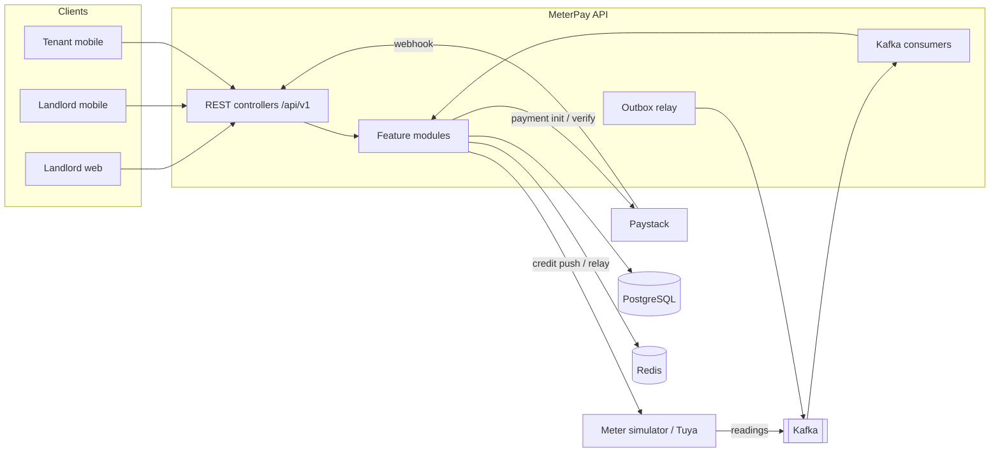
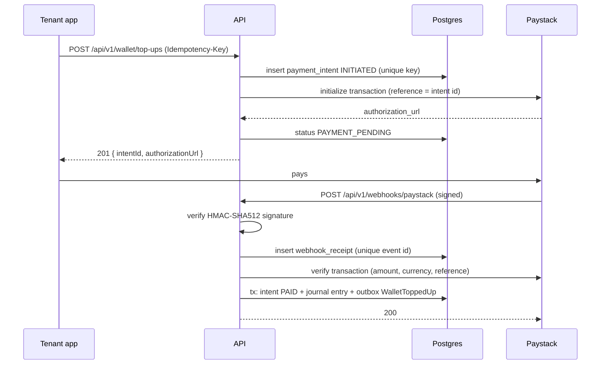

# MeterPay: System Design

Backend for a prepaid electricity sub-metering platform for multi-unit residential buildings in Nigeria. Served by React (landlord web) and React Native (landlord and tenant mobile) frontends, which live in separate repositories.

Base package: `com.theodomart.energy`

---

## 1. Problem

In Nigerian multi-unit buildings (flats, compounds, hostels), one utility meter usually feeds many households. Landlords split the bill by guesswork, tenants dispute it, and the landlord ends up pre-financing everyone's electricity. Prepaid sub-meters fix the hardware side, but someone still has to sell units, track consumption, collect money, and cut off defaulters fairly.

MeterPay lets a landlord register buildings, units and smart meters, set a tariff, and let tenants buy electricity from a wallet. Meters report readings, the platform deducts consumption from each meter's credit, and supply is cut off automatically when credit runs out and restored when the tenant buys more.

## 2. Goals and non-goals

**Goals**
- Correct money: every kobo traceable through a double-entry ledger
- Correct energy: every watt-hour of credit traceable through an append-only meter credit ledger
- Safe payments: idempotent, webhook-confirmed, reconciled
- Reliable telemetry ingestion: duplicate and out-of-order readings handled
- Runs locally with one command and no real hardware (meter simulator)

**Non-goals (v1)**
- Building the frontends in this repo
- Generating STS (Standard Transfer Specification) tokens for legacy keypad meters
- Payouts to landlord bank accounts (revenue is tracked, settlement is manual)
- Multi-currency

## 3. Glossary

| Term | Meaning |
|---|---|
| Building | A property owned or managed by a landlord |
| Unit | A flat or room inside a building |
| Tenancy | A tenant's assignment to a unit for a period |
| Meter | A smart sub-meter installed on a unit |
| Register | The meter's cumulative energy counter (Wh), only ever increases |
| Credit | Prepaid energy available on a meter (Wh) |
| Wallet | A tenant's money balance (kobo) |
| Vend | Converting wallet money into meter credit |
| Cutoff | Opening the meter relay when credit reaches zero |

## 4. Tech stack

| Concern | Choice |
|---|---|
| Language | Java 21 |
| Framework | Spring Boot (latest stable at M0, recorded in ADR-0001) |
| Build | Maven wrapper |
| Database | PostgreSQL 16, Flyway migrations |
| Cache, rate limiting | Redis 7, Bucket4j |
| Messaging | Apache Kafka (KRaft mode, no ZooKeeper) |
| Security | Spring Security, JWT access tokens, rotating refresh tokens |
| Payments | Paystack (behind `PaymentGateway` interface) |
| Meters | `MeterGateway` interface: simulator (default), Tuya adapter (optional profile) |
| API docs | springdoc-openapi |
| Testing | JUnit 5, AssertJ, Mockito, Testcontainers, WireMock, ArchUnit |
| Quality | JaCoCo (coverage gate), Spotless (formatting) |
| CI | GitHub Actions |
| Observability | Actuator, Micrometer, JSON logs with correlation IDs |

## 5. Architecture

Modular monolith. One deployable, internally split into feature modules with enforced boundaries (ArchUnit). Kafka is used for telemetry ingestion and for domain events leaving a module, published through a transactional outbox.



### 5.1 Package layout (package by feature)

```
com.theodomart.energy
├── MeterPayApplication.java
├── common/            errors, ProblemDetail handler, correlation ID, clock, money/energy value types, base entity
├── security/          JWT, filters, SecurityConfig, ownership checks
├── identity/          users, roles, login, refresh tokens
├── property/          buildings, units, tenancies
├── meter/             meter registry, meter state machine
├── tariff/            tariff plans and versions
├── ledger/            accounts, journal entries, postings (money, kobo)
├── payment/           payment intents, Paystack adapter, webhooks, reconciliation
├── vending/           buy energy, meter credit ledger (Wh)
├── telemetry/         reading ingestion, consumption, cutoff and restore
├── alerting/          low credit, tamper detection, notifications
├── audit/             append-only hash-chained audit log
├── reporting/         consumption and revenue reports
├── outbox/            transactional outbox and relay
└── gateway/           MeterGateway interface, simulator, Tuya adapter
```

Inside each feature module:

```
{module}/
├── api/           controllers, request/response DTOs (records)
├── service/       interfaces only
├── serviceImpl/   implementations only
├── domain/        JPA entities, enums, domain logic
├── repository/    Spring Data repositories
└── event/         domain event records (if any)
```

### 5.2 Architecture rules (enforced by ArchUnit tests)

1. Controllers and any other consumer depend on `service` interfaces, never on `serviceImpl`.
2. A module may only call another module through that module's `service` interfaces. No cross-module repository or entity access.
3. Controllers never return JPA entities. Only DTO records.
4. `ledger` and `audit` repositories expose no delete methods.
5. No class outside `common` uses `double` or `float` for money or energy fields.

## 6. Domain model

### 6.1 Units of measure

- Money: `long` kobo, wrapped in a `Money` record. `BIGINT` in Postgres. Never `double`, `float` or `BigDecimal` in entities.
- Energy: `long` watt-hours (Wh), wrapped in an `Energy` record. `BIGINT` in Postgres.
- Tariff rates: kobo per kWh as `long`. Conversion from money to energy uses integer arithmetic with explicit rounding toward the platform (floor of Wh delivered), documented in ADR-0005.
- Time: `Instant` in UTC everywhere. Displayed in Africa/Lagos by clients.

### 6.2 Entities (core fields)

All tables: `id UUID PK`, `created_at TIMESTAMPTZ`, snake_case columns. Mutable tables also have `updated_at` and `version BIGINT` (optimistic locking).

**users**: `email UNIQUE`, `phone UNIQUE`, `password_hash`, `full_name`, `role` (LANDLORD, TENANT, ADMIN), `status` (ACTIVE, DISABLED)

**refresh_tokens**: `user_id`, `token_hash UNIQUE`, `family_id`, `expires_at`, `revoked_at`, `replaced_by`

**buildings**: `landlord_id`, `name`, `address`, `state`, `lga`

**units**: `building_id`, `label` (e.g. "Flat 3B"), UNIQUE(`building_id`, `label`)

**tenancies**: `unit_id`, `tenant_id`, `starts_on`, `ends_on NULL`, `status` (ACTIVE, ENDED). Partial unique index: one ACTIVE tenancy per unit.

**meters**: `unit_id UNIQUE NULL`, `serial_number UNIQUE`, `gateway_type` (SIMULATED, TUYA), `external_device_id`, `status`, `last_register_wh`, `last_reading_at`, `credit_balance_wh`, `low_credit_threshold_wh`

**tariff_plans**: `building_id`, `name`
**tariff_versions**: `plan_id`, `rate_kobo_per_kwh`, `vat_basis_points` (750 = 7.5%), `platform_fee_basis_points`, `effective_from`. Versions are immutable. The active version is the latest with `effective_from <= now`.

**ledger_accounts**: `owner_type` (TENANT, LANDLORD, PLATFORM), `owner_id NULL`, `type` (see 6.3), `currency` ('NGN'), `balance_kobo`, `version`. UNIQUE(`owner_type`, `owner_id`, `type`).

**journal_entries**: `entry_type` (WALLET_TOPUP, ENERGY_PURCHASE, REFUND, ADJUSTMENT), `reference_type`, `reference_id`, `idempotency_key UNIQUE`, `description`, `posted_at`
**postings**: `journal_entry_id`, `account_id`, `direction` (DEBIT, CREDIT), `amount_kobo > 0`

**payment_intents**: `tenant_id`, `amount_kobo`, `status`, `idempotency_key UNIQUE`, `gateway`, `gateway_reference UNIQUE`, `authorization_url`, `failure_reason`, `paid_at`
**payment_events**: append-only log of every gateway interaction (`intent_id`, `event_type`, `payload JSONB`, `correlation_id`)
**webhook_receipts**: `gateway`, `event_id UNIQUE`, `signature_valid`, `payload JSONB`, `processed_at`

**energy_purchases**: `tenant_id`, `meter_id`, `amount_kobo`, `vat_kobo`, `fee_kobo`, `net_kobo`, `energy_wh`, `tariff_version_id`, `journal_entry_id`, `idempotency_key UNIQUE`, `status` (COMPLETED, CREDIT_PUSH_PENDING, CREDIT_PUSHED)
**meter_credit_entries**: append-only. `meter_id`, `type` (PURCHASE, CONSUMPTION, ADJUSTMENT), `delta_wh` (signed), `balance_after_wh`, `reference_id`

**meter_readings**: `meter_id`, `register_wh`, `voltage_dv` (decivolts), `power_w`, `relay_closed BOOLEAN`, `read_at`, `received_at`. UNIQUE(`meter_id`, `read_at`). Partitioned by month (range on `read_at`) from M6.

**alerts**: `meter_id`, `type` (LOW_CREDIT, CUTOFF, TAMPER_REGISTER_DECREASE, TAMPER_CONSUMPTION_WHILE_CUTOFF, READING_GAP), `severity`, `status` (OPEN, ACKNOWLEDGED, RESOLVED), `details JSONB`

**audit_log**: append-only. `actor_id`, `action`, `target_type`, `target_id`, `payload JSONB`, `prev_hash`, `hash`, `occurred_at`. `hash = SHA-256(prev_hash || canonical_json(row without hash))`.

**outbox_events**: `aggregate_type`, `aggregate_id`, `event_type`, `payload JSONB`, `created_at`, `published_at NULL`, `attempts`

### 6.3 Ledger accounts

| Account | Owner | Normal balance |
|---|---|---|
| TENANT_WALLET | Tenant | Credit (liability: money we hold for the tenant) |
| LANDLORD_REVENUE | Landlord | Credit |
| GATEWAY_CLEARING | Platform | Debit (money in transit from Paystack) |
| VAT_PAYABLE | Platform | Credit |
| PLATFORM_FEE_REVENUE | Platform | Credit |

**Invariants (tested):**
- Every journal entry has at least two postings and total debits equal total credits.
- Postings and journal entries are never updated or deleted. Corrections are new reversing entries.
- A TENANT_WALLET balance can never go below zero. Enforced in code under a row lock or optimistic version check, plus a DB CHECK on a constrained balance column.
- `SUM(balance_kobo)` across accounts, signed by normal balance, is always zero. A scheduled job verifies this and raises an alert if not.

### 6.4 Posting recipes

**Wallet top-up confirmed (₦5,000):**
| Account | Debit | Credit |
|---|---|---|
| GATEWAY_CLEARING | 500000 | |
| TENANT_WALLET | | 500000 |

**Energy purchase (₦2,000, VAT 7.5% inclusive, fee 2%):**
- gross = 200000, vat = gross × 750 / 10750 (floor) = 13953, fee = (gross − vat) × 200 / 10000 (floor) = 3720, net = gross − vat − fee = 182327

| Account | Debit | Credit |
|---|---|---|
| TENANT_WALLET | 200000 | |
| VAT_PAYABLE | | 13953 |
| PLATFORM_FEE_REVENUE | | 3720 |
| LANDLORD_REVENUE | | 182327 |

Energy delivered = floor(net_kobo × 1000 / rate_kobo_per_kwh) Wh. At ₦225/kWh (22500 kobo): floor(182327 × 1000 / 22500) = 8103 Wh. (Whether VAT and fees reduce energy or are charged on top is a product decision recorded in ADR-0005.)

## 7. State machines

### 7.1 Payment intent

```
INITIATED --gateway init ok--> PAYMENT_PENDING
INITIATED --gateway init failed--> FAILED
PAYMENT_PENDING --webhook charge.success / verify success--> PAID
PAYMENT_PENDING --webhook failed / verify failed--> FAILED
PAYMENT_PENDING --expired (60 min) after final verify--> FAILED
PAID --refund issued--> REFUNDED
```

- The intent row is created and committed BEFORE calling Paystack.
- `idempotency_key` = SHA-256(`tenant_id` + client `Idempotency-Key` header). Enforced by the UNIQUE constraint, not by check-then-insert. A duplicate insert returns the existing intent.
- Transitions are guarded in one place (`PaymentIntent.transitionTo`). Illegal transitions throw `IllegalStateTransitionException` (409).
- PAID is reached at most once. The wallet credit posting uses `idempotency_key = "topup:" + intent_id`, so even a double webhook cannot double-credit.

### 7.2 Meter

```
PROVISIONED --assigned to unit + first reading--> ACTIVE
ACTIVE --credit <= threshold--> LOW_CREDIT
LOW_CREDIT --credit > threshold--> ACTIVE
ACTIVE|LOW_CREDIT --credit <= 0--> CUTOFF          (relay open command sent)
CUTOFF --purchase credits meter--> ACTIVE          (relay close command sent)
any operational --tamper rule fires--> TAMPER_SUSPECTED
TAMPER_SUSPECTED --admin/landlord clears--> previous state
any --landlord suspends--> SUSPENDED
SUSPENDED --landlord resumes--> previous state
any --decommission--> DECOMMISSIONED (terminal)
```

Credit enforcement is two-layered: the purchased Wh is pushed to the meter (edge enforced), and the cloud independently opens the relay at zero (cloud enforced). If the meter keeps reporting consumption while CUTOFF, a TAMPER_CONSUMPTION_WHILE_CUTOFF alert fires.

## 8. Key flows

### 8.1 Wallet top-up



Fallbacks: a reconciliation job runs every 5 minutes and verifies PAYMENT_PENDING intents older than 10 minutes. `GET /api/v1/wallet/top-ups/{id}` also triggers a verify when the intent is still pending.

### 8.2 Buy energy

1. `POST /api/v1/meters/{meterId}/purchases` with amount and `Idempotency-Key`.
2. Check the caller is the active tenant of the meter's unit.
3. Load the active tariff version (cached in Redis, evicted on new version).
4. In one transaction: post the journal entry (fails with 422 `insufficient-wallet-balance` if the wallet is short), insert `energy_purchases`, append `meter_credit_entries` PURCHASE, update `meters.credit_balance_wh` with optimistic locking, write outbox `EnergyPurchased`.
5. Outbox relay publishes the event. A consumer calls `MeterGateway.pushCredit` and, if the meter was CUTOFF, `setRelay(CLOSED)`. Retries with backoff. Purchase moves to CREDIT_PUSHED.

### 8.3 Telemetry ingestion

1. Simulator (or Tuya bridge) publishes `MeterReading` to topic `meter.readings.v1`, keyed by `meter_id` (preserves per-meter ordering).
2. Consumer inserts into `meter_readings`. A duplicate (`meter_id`, `read_at`) is ignored (idempotent consumer).
3. Older-than-last readings are stored but do not trigger deduction.
4. `consumed_wh = register_wh − meters.last_register_wh`. If negative, raise TAMPER_REGISTER_DECREASE and skip deduction.
5. Append CONSUMPTION credit entry, update balance, evaluate thresholds, transition meter state, emit `LowCredit` / `MeterCutoff` events.
6. Failed messages go to `meter.readings.v1.DLT` after 3 retries.

### 8.4 Kafka topics

| Topic | Key | Producer | Consumer |
|---|---|---|---|
| `meter.readings.v1` | meter_id | simulator / Tuya bridge | telemetry |
| `energy.events.v1` | aggregate_id | outbox relay | vending (credit push), alerting |
| `meter.readings.v1.DLT` | meter_id | error handler | manual replay |

## 9. API (v1)

All endpoints under `/api/v1`. JSON. Pagination via `page`, `size` (max 100), returns `{ content, page, size, totalElements }`. Mutating money endpoints require an `Idempotency-Key` header.

**Auth**
| Method | Path | Role |
|---|---|---|
| POST | /auth/register | public (LANDLORD or TENANT via invite code) |
| POST | /auth/login | public |
| POST | /auth/refresh | public (refresh token) |
| POST | /auth/logout | authenticated |
| GET | /me | authenticated |

**Property**
| Method | Path | Role |
|---|---|---|
| POST, GET | /buildings | LANDLORD |
| GET, PATCH | /buildings/{id} | LANDLORD (owner) |
| POST, GET | /buildings/{id}/units | LANDLORD (owner) |
| POST | /units/{id}/invites | LANDLORD (owner): creates tenant invite code |
| POST | /units/{id}/tenancy/end | LANDLORD (owner) |

**Meters and tariffs**
| Method | Path | Role |
|---|---|---|
| POST | /meters | LANDLORD: register meter |
| PUT | /meters/{id}/unit | LANDLORD: assign to unit |
| GET | /meters/{id} | LANDLORD (owner), TENANT (occupant) |
| POST | /meters/{id}/suspend, /resume | LANDLORD (owner) |
| GET | /meters/{id}/readings?from&to | owner, occupant |
| POST, GET | /buildings/{id}/tariffs | LANDLORD (owner): new version |

**Wallet and payments**
| Method | Path | Role |
|---|---|---|
| GET | /wallet | TENANT |
| GET | /wallet/transactions | TENANT |
| POST | /wallet/top-ups | TENANT |
| GET | /wallet/top-ups/{id} | TENANT (owner) |
| POST | /webhooks/paystack | Paystack (signature verified) |

**Vending**
| Method | Path | Role |
|---|---|---|
| POST | /meters/{id}/purchases | TENANT (occupant) |
| GET | /meters/{id}/purchases | owner, occupant |

**Alerts, reports, admin**
| Method | Path | Role |
|---|---|---|
| GET | /alerts | LANDLORD (own buildings) |
| POST | /alerts/{id}/acknowledge, /resolve | LANDLORD (owner) |
| GET | /reports/buildings/{id}/consumption?period | LANDLORD (owner) |
| GET | /reports/buildings/{id}/revenue?period | LANDLORD (owner) |
| GET | /admin/audit/verify | ADMIN: verifies hash chain |
| GET | /admin/ledger/trial-balance | ADMIN |

## 10. Error handling

A single `@RestControllerAdvice` maps exceptions to RFC 9457 `ProblemDetail`:

```json
{
  "type": "https://meterpay.theodomart.com/problems/insufficient-wallet-balance",
  "title": "Insufficient wallet balance",
  "status": 422,
  "detail": "Wallet balance is ₦1,200.00 but the purchase requires ₦2,000.00",
  "instance": "/api/v1/meters/6f1c.../purchases",
  "code": "INSUFFICIENT_WALLET_BALANCE",
  "traceId": "a1b2c3d4"
}
```

| Exception | Status | code |
|---|---|---|
| `MethodArgumentNotValidException` | 400 | VALIDATION_FAILED (with `errors[]` field list) |
| `AuthenticationException` | 401 | UNAUTHENTICATED |
| `AccessDeniedException`, `NotOwnerException` | 403 | FORBIDDEN |
| `ResourceNotFoundException` | 404 | NOT_FOUND |
| `IllegalStateTransitionException` | 409 | ILLEGAL_STATE_TRANSITION |
| `OptimisticLockingFailureException` (after retries) | 409 | CONCURRENT_MODIFICATION |
| `IdempotencyConflictException` (same key, different body) | 422 | IDEMPOTENCY_KEY_REUSED |
| `InsufficientWalletBalanceException` | 422 | INSUFFICIENT_WALLET_BALANCE |
| `MeterNotOperationalException` | 422 | METER_NOT_OPERATIONAL |
| `RateLimitExceededException` | 429 | RATE_LIMITED (+ `Retry-After`) |
| `PaymentGatewayException` | 502 | PAYMENT_GATEWAY_ERROR |
| anything else | 500 | INTERNAL_ERROR (no stack trace in body, logged with traceId) |

Ownership failures on another landlord's resources return 404, not 403, so resource IDs cannot be probed.

## 11. Security

- Passwords: BCrypt (strength 12).
- Access token: JWT, 15 minutes, HS256 secret from env (`JWT_SECRET`), claims `sub`, `role`.
- Refresh token: opaque random 256-bit, stored hashed, 30 days, rotated on every use. Reuse of a rotated token revokes the whole family.
- Ownership checks live in services (`OwnershipService`), not only in controllers.
- Paystack webhook: HMAC-SHA512 of the raw body with the secret key, compared in constant time. Endpoint excluded from JWT but rate limited and IP allowlist optional.
- Rate limits (Bucket4j + Redis): login 5/min per IP+email, money endpoints 20/min per user, global 300/min per IP.
- No secrets in the repo. `.env.example` documents every variable.
- CORS restricted to configured frontend origins.

## 12. Observability

- `X-Correlation-Id` header accepted or generated, put in MDC, returned in responses and included as `traceId` in problem details.
- JSON logs in prod profile. Payment logs always include `intentId` and `correlationId`.
- Metrics: `meterpay.payments.paid`, `meterpay.vends.total`, `meterpay.readings.ingested`, `meterpay.readings.lag`, `meterpay.ledger.imbalance`.
- Actuator health groups for liveness and readiness (DB, Redis, Kafka).

## 13. Testing strategy

| Layer | Tooling | What |
|---|---|---|
| Unit | JUnit 5, AssertJ | money/energy math, tariff calc, state machines, hash chain |
| Slice | `@WebMvcTest` | controllers, validation, problem details |
| Integration | `@SpringBootTest` + Testcontainers (Postgres, Redis, Kafka) | flows end to end, Flyway migrations, real constraints |
| External | WireMock | Paystack init, verify, failures, timeouts |
| Architecture | ArchUnit | rules in 5.2 |
| Concurrency | `ExecutorService` + `CountDownLatch` | 20 parallel purchases on one wallet never overdraw; double webhook credits once |

Coverage gate: JaCoCo fails the build below 75% line coverage on `serviceImpl`, `domain` and `ledger` packages. Badge published in README.

Required named tests (portfolio evidence):
- `ConcurrentPurchaseIT.parallelPurchasesNeverOverdrawWallet`
- `PaystackWebhookIT.duplicateWebhookCreditsWalletOnce`
- `PaystackWebhookIT.invalidSignatureIsRejected`
- `LedgerInvariantTest.everyJournalEntryBalances`
- `TelemetryIT.duplicateReadingIsIgnored`
- `TelemetryIT.registerDecreaseRaisesTamperAlert`
- `CutoffIT.meterIsCutOffAtZeroAndRestoredAfterPurchase`
- `AuditChainTest.tamperedRowBreaksVerification`

## 14. Local run and deployment

- `docker compose up` starts Postgres, Redis, Kafka (KRaft), the API and the meter simulator with seed data (one landlord, one building, three units, three tenants, three simulated meters).
- Profiles: `local` (simulator, Paystack test keys or WireMock stub), `test`, `prod` (Tuya optional, JSON logs).
- Dockerfile: multi-stage, layered jar, non-root user.
- Prod target: Oracle Always Free VM behind Nginx, subdomain `meterpay.theodomart.com`, Let's Encrypt.

## 15. Architecture decision records (docs/adr)

| ADR | Decision |
|---|---|
| 0001 | Modular monolith over microservices |
| 0002 | Money and energy as integer minor units |
| 0003 | Double-entry ledger instead of a balance column |
| 0004 | Transactional outbox instead of publishing to Kafka inside the transaction |
| 0005 | Tariff, VAT and fee rounding rules |
| 0006 | Two-layer credit enforcement (edge + cloud) |
| 0007 | Idempotency via DB unique constraint |
| 0008 | Hash-chained audit log |
| 0009 | MeterGateway abstraction and simulator |
